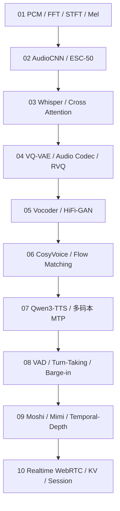

# 从声音数字化到全双工 Speech-to-Speech：10 节可复现语音 AI 课程

> 中文学习项目 · 由一套连续学习对话与可运行实验整理 · PCM / STFT / Whisper / Audio Codec / VQ-VAE / Vocoder / Flow / Qwen3-TTS / Moshi / Realtime S2S

适合有 **CNN / Transformer / Python / PyTorch** 基础，正从图像模型转到语音模型的学习者。课程从“声音为什么能数字化”一路讲到“为什么端到端全双工可以一边听一边说”，并记录学习过程中重要的疑问、试验、误解和纠错。

本仓库包含：**10 节中文讲义 + 原始教学实验代码 + 55 个整理后的核心问答 + ESC-50 数据故障复盘 + 5 组补充实验 + 参考架构 / 上传指南**。

**使用范围说明**：这是教学复现仓库，不是 OpenAI、Moshi、CosyVoice 或 Sophon 的官方代码，也不是训练完成的原生 S2S 生产模型。预训练模型示例需另行下载权重；多数 CPU 实验运行的是 toy 模型或合成音调。脚本是否已经本地实测、数据是否是合成、哪些性能数字是模拟，均明确标注在讲义与 [`docs/evidence-and-limitations.md`](docs/evidence-and-limitations.md)。

## 学习路线



| 课程 | 关键问题 | 核心代码 | 课程讲义 |
|---|---|---|---|
| 01 · 声音基础 | 声音如何采样、变成频谱？ | `lesson1.py` | [PCM → STFT → Log-Mel](lessons/01-pcm-stft-logmel/README.md) |
| 02 · 声音分类 | CNN 看懂什么样的时频纹理？ | `train_audio_cnn.py` | [AudioCNN / ESC-50](lessons/02-audio-cnn-esc50/README.md) |
| 03 · ASR | Encoder、Decoder、词表与 Cross Attention 怎样连起来？ | `lesson3_whisper.py` / `cross_attention_toy.py` | [Whisper](lessons/03-whisper-asr/README.md) |
| 04 · Audio Codec | 为什么重建、为什么离散码本？ | `lesson4_rvq_lab.py` | [Neural Codec / RVQ](lessons/04-neural-codec/README.md) |
| 05 · Vocoder | 为什么 Mel 不等于可播放的波形？ | `lesson5_vocoder_lab.py` | [Vocoder / HiFi-GAN](lessons/05-vocoder-hifigan/README.md) |
| 06 · Flow | 从噪声到频谱的“方向”如何学习？ | `toy_flow_matching.py` | [CosyVoice / Flow](lessons/06-cosyvoice-flow/README.md) |
| 07 · TTS | 多码本如何由大模型 + 小模型生成？ | `toy_multicodebook.py` | [Qwen3-TTS](lessons/07-qwen3-tts/README.md) |
| 08 · 话轮 | 静音 ≠ 用户说完，如何打断？ | `lesson8_turn_lab.py` | [VAD / Turn-Taking](lessons/08-vad-turn-taking/README.md) |
| 09 · 双工模型 | 为什么要 Temporal / Depth 两个轴？ | `lesson9_moshi_toy.py` | [Moshi / Mimi](lessons/09-moshi-full-duplex/README.md) |
| 10 · 工程实现 | WebRTC、KV Cache、打断与延迟如何协同？ | `lesson10_simulator.py` | [完整 S2S 架构](lessons/10-realtime-system/README.md) |

## 五分钟快速开始

建议使用 **Python 3.10/3.11、CPU** 跑首个实验，后面再安装 GPU/预训练依赖。

```bash
python -m venv .venv
source .venv/bin/activate              # Windows: .venv\Scripts\activate
pip install -r requirements/base.txt
python lessons/01-pcm-stft-logmel/code/lesson1.py
```

如果你有 PyTorch：

```bash
pip install -r requirements/pytorch.txt
python lessons/03-whisper-asr/code/cross_attention_toy.py
python lessons/02-audio-cnn-esc50/code/train_audio_cnn.py --epochs 6
```

继续：

```bash
python lessons/04-neural-codec/code/lesson4_rvq_lab.py
python lessons/05-vocoder-hifigan/code/lesson5_vocoder_lab.py \
  --input lessons/05-vocoder-hifigan/code/demo_synthetic.wav \
  --output-dir outputs/lesson05 --iterations 16
python lessons/06-cosyvoice-flow/code/toy_flow_matching.py --steps 500
```

`requirements/` 包含不同任务的依赖。部分脚本依赖 Torch、Torchaudio 或 HF 下载，不建议在同一个系统 Python 中全部无差别安装；参阅 [安装与运行建议](docs/installation.md)。

**单文件合订阅读**：[COURSE_COMPLETE.md](COURSE_COMPLETE.md) · [FAQ_COMPLETE.md](FAQ_COMPLETE.md)

## 用原始问题组织学习

你可以按“问题→解答→实验复现”的顺序阅读，**不必重看十节长课才能找到某一个疑问**。

- [55 个问答与学习轨迹](docs/qa/README.md)
- [ESC-50 dog 黄屏归一化故障完整复盘](docs/qa/05-esc50-case-study.md)
- [概念索引：从 PCM 到 MoE](docs/glossary.md)
- [易混淆概念与已知纠错](docs/corrections.md)
- [模型与服务的双层架构图](docs/architecture.md)
- [课程验收 / 压测指标](docs/acceptance.md)

### 补充实验（不属于固定十课顺序）

| 专题 | 代码 | 作用 |
|---|---|---|
| 图像 VQ-VAE | [extras/vqvae/train_vqvae.py](extras/vqvae/train_vqvae.py) | 看原图、Codebook、重建图如何共同训练 |
| 一维条件 Flow | [extras/conditional-flow-1d/conditional_flow_1d.py](extras/conditional-flow-1d/conditional_flow_1d.py) | 用两个目标分布理解速度场 |
| 相位与叠加 | [extras/phase/phase_lab.py](extras/phase/phase_lab.py) | 0°/90°/180°/360°试听 |
| ESC-50 归一化 | [extras/esc50-normalization/compare_normalization.py](extras/esc50-normalization/compare_normalization.py) | 直接复现“安静片段变黄”现象 |
| Dense vs MoE | [extras/dense-vs-moe/moe_toy.py](extras/dense-vs-moe/moe_toy.py) | 验证 Top-2 Router 的激活与梯度 |

[源码恢复与新增文件清单](SOURCE_MANIFEST.md) · [本次运行验证记录](VALIDATION.md)

## 仓库目录

```text
voice-ai-from-zero-to-full-duplex/
├── README.md                  课程入口
├── GITHUB_UPLOAD.md           发布到 GitHub 的命令
├── requirements/              分层依赖
├── lessons/                   01～10，每课 README、code、部分 figures/samples
├── extras/                    VQ-VAE / Phase / Flow / ESC-50 / MoE
├── docs/
│   ├── qa/                    55个问答及数据案例
│   ├── architecture.md         端到端架构图
│   ├── glossary.md             术语表
│   ├── corrections.md          课程纠错
│   ├── evidence-and-limitations.md
│   └── references.md           官方项目与论文
└── scripts/                   本地结构检查与实验验证
```

## 课程材料的来源与公开范围

- 讲义和问答从**本次学习对话中实际可见的内容**整理，属于教学笔记和归纳回答，**不是逐字完整聊天记录**。原始平台 UI、无法恢复的轮次、隐藏思维过程不在仓库里。
- 找回的原始教学 `.py` 代码保留在对应课程 `code/` 下；增加的专用实验位于 `extras/`。正式预训练权重需要从各项目自行下载。
- 公开样例优先为合成音调/数学图像；**没有把原始语音录音、ESC-50 WAV 数据、第三方预训练权重上传进 GitHub 包**。
- 开源第三方项目/模型具有各自许可；当前 MIT 只覆盖本仓库原创教学内容与教学代码。参见 [证据与限制](docs/evidence-and-limitations.md)。
