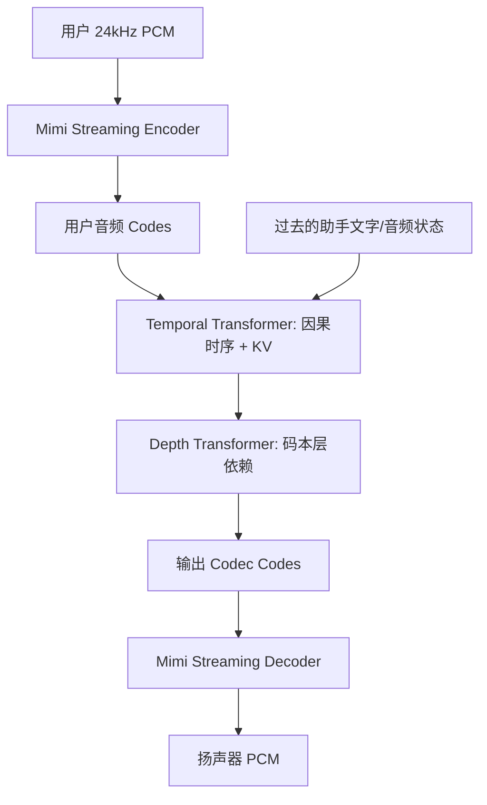
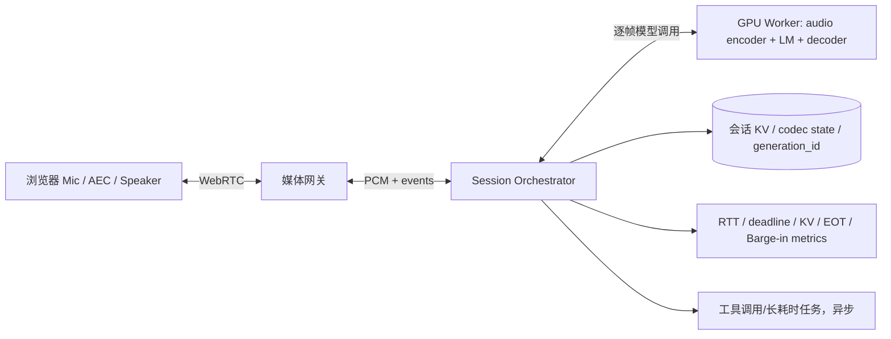

# 两层架构：模型内部 + 系统外部

## A. 端到端模型内部（以 Moshi 类模型为例）

该图是概念化的数据分工；真实实现的语义与声学流有时间延迟、特殊 Token 和多种条件，不能照这个图直接实现 Moshi 等价模型。

## B. 服务与控制面（可自行搭建）

## C. 训练 vs 推理

训练 Audio Codec：`原始音频 → Encoder → 码本 → Decoder → 重建 → Loss`；录音本身提供监督信号。训练 TTS Talker：`文字/音色 → 模型预测 Codec Codes`，真实录音经过 Codec Encoder 得到监督码本 ID。训练原生全双工 S2S：不仅要学习语音 Token 的分布，还要学双方交叠、停顿、打断、附和、时间对齐等行为。

## D. 工程中的五个“时间”

| 时间概念 | 单位 | 注意 |
|---|---|---|
| PCM 采样间隔 | μs | 24kHz 下约41.7μs一个采样点 |
| 浏览器采集/发送帧 | ms | 比如20ms，不等于模型帧 |
| Codec 时间步 | ms | Mimi 常见80ms/帧 |
| 模型实际推理耗时 | ms | 应测每步 P50/P95/P99，不能从帧长倒推 |
| Flow 积分时间 t | 0～1（无单位） | 生成过程变量，不等于真实声音时间 |

## E. 模型选择问题

若目标是“弄懂模型内部全双工”，优先研究 Moshi；若目标是“带产品话轮控制的 S2S”，可研究 Sophon-Realtime；若目标是“可靠 WebRTC 浏览器体验”，考虑 LiveKit Agent 等媒体基础设施。具体部署要以当前仓库版本及模型许可为准。
