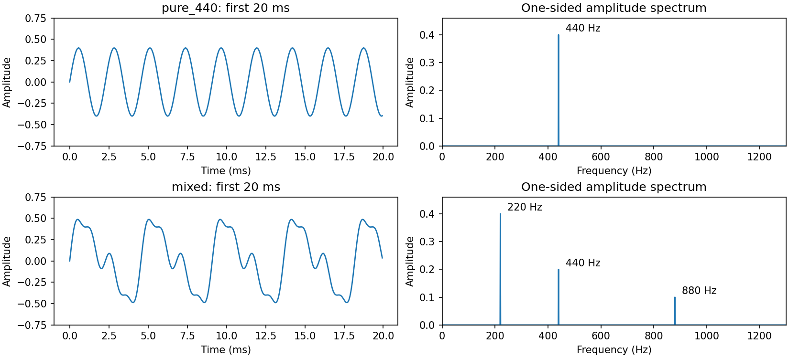

# 第01课｜从声音到数字：PCM、频率、FFT、STFT、Mel、MFCC

> **本课目标**：能解释声音为什么是气压随时间的变化；写出波形与频谱的形状；看懂低通与高通滤波；生成并试听自己的合成波形。

## 一眼看懂数据流

```text
空气中的气压变化 → 麦克风模拟电压 → ADC 离散采样 → PCM 波形 → STFT 复数频谱 → 功率谱 → Mel 滤波器组 → Log-Mel / MFCC
```

## 1. 输入到底是什么

人耳感受的是空气压力的振动，而不是“频率本身”。麦克风把压力变化变成电压；ADC 每秒读取若干次，得到 PCM 数列。**采样率 16 kHz** 表示每秒有 16,000 个采样时刻，而不是音量范围为 0～16,000。

```text
1 秒单声道 16kHz PCM: [16000]
Batch 化:                 [B, 16000]
16-bit PCM 文件:          通常 int16，范围 -32768..32767
神经模型输入:              常转换为浮点数，约 [-1, 1]
```

图像是 `H×W×3` 像素矩阵；音频首先是按时间排列的一维振幅序列。声音的“音高”主要与周期及基频有关；“响度”大体与振幅/感知频谱有关；“音色”依赖谐波分布、包络、瞬态与更多结构。

## 2. 为什么要傅里叶变换

原始波形可以呈现周期，但很难一眼看出多个频率同时存在。FFT 将一个时间窗中的振动表示为不同频率的复数系数：复数的模表示幅度，相角表示相位。

- **FFT**：分析所选整段窗口的频率成分；不保留多段事件各自在何时发生。
- **STFT**：不断截取短窗口做 FFT；把频率谱沿时间排成二维图。
- **功率谱**：常使用 `abs(STFT)**2`，丢掉原始相位。
- **Mel 滤波组**：把线性 Hz 频率分量汇总到接近听觉分辨方式的频带，不是 CNN 自己训练出来的滤波器。
- **Log-Mel**：压缩动态范围，适合用于声学模型；不能唯一恢复原始 PCM。
- **MFCC**：进一步用 DCT 表示 Mel 对数谱形态，经典语音特征之一。

以 `n_fft=400, hop=160, center=False, sr=16000` 为例，1 秒信号 `T=16000`，STFT 时间帧数为 `floor((16000-400)/160)+1=98`；线性频率维度是 `400/2+1=201`；80个 Mel 滤波器得到 `[80,98]`。

## 3. 滤波是怎么一回事

一个低通滤波器允许低频通过、减弱高频；高通恰好相反。第一课配套合成 `220Hz、440Hz、880Hz`，可以在频谱上逐条验证。滤波器并不是简单删掉音频时间轴上的某些点，而是改变各频率成分的幅度（实际还可能改变相位）。

## 4. 与后续模型的联系

`Log-Mel` 是 Whisper 等 ASR 的常见输入；而 Moshi/Mimi 的神经 Codec 可以直接从 PCM 中学习压缩表示。STFT 和 Mel 是数字信号处理方法，不以深度学习的出现为前提。

## 5. 已知陷阱

- Mel bin 40 **不是** 40Hz；纵轴是经过非线性分组的频率索引。
- 频谱颜色代表所选参考与颜色范围内的强弱；不同图片独立归一化时，亮度不可简单横向比较。
- `center=True/False` 会改变边界补齐与时间帧数，实验要标明。
- 振幅不能直接和物理声压/感知响度做绝对等号。

## 动手运行

从**仓库根目录**执行：

```bash
python lessons/01-pcm-stft-logmel/code/lesson1.py
```

> 如本课含可下载权重的官方示例，先阅读 `../../docs/installation.md`，该步骤不计入无需网络的 CPU 实验。

## 实验图示（合成或教学数据）



## 课程附带素材 / 预期结果

- `figures/fft.png`：纯音与混合音的 FFT
- `figures/sequence_analysis.png`：时域切换造成的时频变化
- `samples/*.wav`：数学合成的可公开音调

## 验收题

- [ ] 能说明 16kHz PCM 数组长度
- [ ] 能算出 `[201,98]` 与 `[80,98]`
- [ ] 能区分 FFT 与 STFT
- [ ] 能解释幅度、相位与 Mel 的区别

## 论文与官方项目

- https://librosa.org/doc/latest/index.html

**延伸问答**：参见 [问答索引](../../docs/qa/README.md)；实验性质说明见 [证据与限制](../../docs/evidence-and-limitations.md)。
