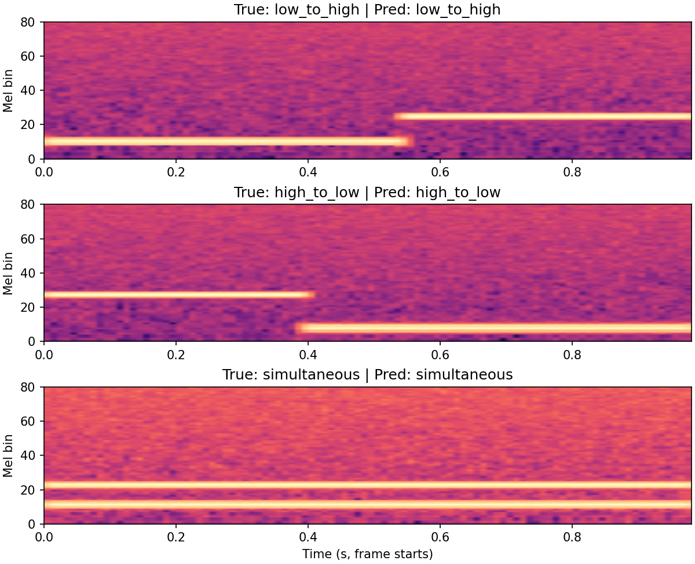

# 第02课｜AudioCNN：从时频纹理到声音分类、ESC-50 与数据泄漏

> **本课目标**：训练三类高低音顺序识别器，观察 logits / embedding；理解真实 ESC-50 时频结构和错误归一化造成的伪特征。

## 一眼看懂数据流

```text
PCM → STFT → Log-Mel `[B,1,80,98]` → Conv2D → Pooling → Embedding `[B,512]` → Linear(512,3) → Softmax
```

## 1. 我们要分类什么

教学任务用合成的三种声音：`low_to_high`（先低后高）、`high_to_low`（先高后低）及 `simultaneous`（高低同时出现）。音频片段为1秒、16kHz。它们频率成分可以接近，但**时间排列不同**；因此需要二维时频纹理而非仅仅一个整段 FFT。

训练脚本生成不同频率、相位、音量、噪声和切换时刻，使模型学到比较通用的时频变化规律。网络约6千余个参数；最后 `Linear(512,3)` 固定输出三个 logits，经过 Softmax 得到类别分布。**单样本54.6%的最大 Softmax 概率，不等于整个模型54.6%的准确率。**

## 2. 真实声音的时频线索

ESC-50 包含50种环境声音。典型图形：雨声是持续宽频颗粒纹理，海浪有慢速能量起伏，引擎/吸尘器有相对稳定的窄频线，警笛有上升/下降的频率轨迹，鸟鸣/蟋蟀呈高频重复短线，婴儿哭/公鸡有谐波组合，狗叫/玻璃破碎有突发宽频事件，雷声低频能量更明显。

这些只是统计倾向，单个图案不保证唯一类别。每类只有40条数据，迁移到50类分类时需要分离好训练/验证/测试数据，宜使用原始的五折分组进行交叉验证。

## 3. 问答中发现的归一化陷阱（重点案例）

用户发现真实 ESC-50 的 dog 图有大片亮黄色，进一步用统计数据定位：`dog: ≥0.9 的像素占80.1%，p50≈1.00；rooster 40.6%，rain 1.1%，crickets 1.0%`。原因并不主要是谐波，而是**每个1秒片段独立按峰值归一化**，再拼成5秒。安静片段内“最大值”也来自背景噪声甚至数值下限；减去自身最大值后，背景会被抬到接近1。

教学脚本中的数学形式为：

```python
# db: [mel_bins, frames]
relative_db = db - db.amax()  # 如果每秒都重新计算，跨秒强度失真
normalized = (relative_db.clamp(-80, 0) + 80) / 80
```

这不是 Matplotlib 画错，也不是“亮黄代表真实声音很响”。对于稀疏事件，推荐做实验对比：**1秒独立归一化 / 5秒统一峰值 / 固定 dB 参考**。详细讨论见 [`docs/qa/05-esc50-case-study.md`](../../docs/qa/05-esc50-case-study.md)。

## 4. 标注粒度与弱监督

5秒录音被标成 dog，不表示随机截取的每一秒都有狗叫。把无事件片段强行标为 dog 会引入噪声标签、促使模型记住录音背景。对比5秒整段分类、事件感知裁剪，或 MIL（多个片段聚合成录音级分类）是合理的进阶实验。

## 5. 模型可解释性

`Embedding [B,512]` 是模型提取的全局特征，不是512个频率，也不是512个 Speech Token。经过全局池化它可能舍弃大量时间和音色细节，所以它不能直接替代 Whisper 的时序 Encoder 或可重建声音的 Codec Latent。

## 动手运行

从**仓库根目录**执行：

```bash
python lessons/02-audio-cnn-esc50/code/train_audio_cnn.py --epochs 6
```

> 如本课含可下载权重的官方示例，先阅读 `../../docs/installation.md`，该步骤不计入无需网络的 CPU 实验。

## 实验图示（合成或教学数据）



## 课程附带素材 / 预期结果

- `figures/samples.png`：三类声音的 Log-Mel
- `samples/*.wav`：合成分类样例
- 生成的 `results/training_curves.png`、`history.csv`、`audio_cnn.pt`（默认不会提交 Git）

## 验收题

- [ ] 三分类可训练并打印混淆矩阵
- [ ] 解释 logits 与 embedding 的区别
- [ ] 解释为什么 ESC-50 不能任意随机切分
- [ ] 能够复现按片段归一化造成的伪黄色

## 论文与官方项目

- https://github.com/karolpiczak/ESC-50

**延伸问答**：参见 [问答索引](../../docs/qa/README.md)；实验性质说明见 [证据与限制](../../docs/evidence-and-limitations.md)。
