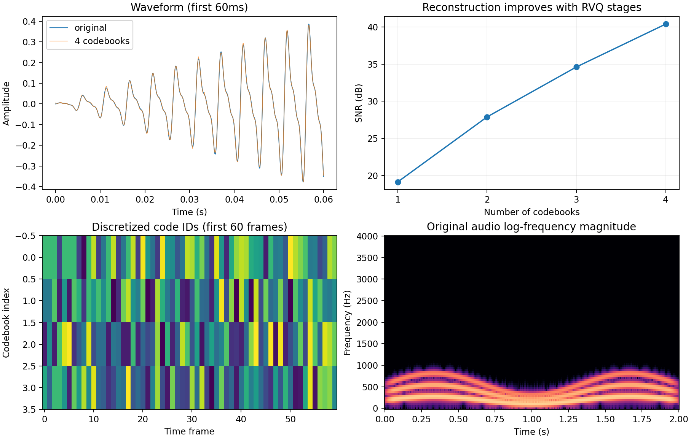

# 第04课｜神经音频编解码、VQ-VAE、Codebook 与 Residual VQ

> **本课目标**：通过码本 ID 的最近邻查表、残差多级量化、波形重建，理解 Speech Token 为什么能降低生成序列长度。

## 一眼看懂数据流

```text
PCM `[B,1,N]` → Audio Encoder → Latent `[B,D,T]` → VQ/RVQ → Codes `[B,K,T]` → Codebook Lookup → Decoder → PCM
```

## 1. 为什么要重建，而不是分类

“可恢复表示”指 Encoder 在**Decoder 不能看到原始数据**的前提下，只提供一个压缩的中间表示；模型通过原始与重建信号的差异学习哪些信息必须保留。这不是为了生成另一张猫图或另一句话，而是为了获得以后可以复用的声学表示体系。

VQ-VAE 在图像中是 `RGB → Conv2D Encoder → [B,H',W',D] → Codebook ID → Decoder → 重建RGB`；音频中改成一维时间：`PCM → Conv1D Encoder → [B,D,T] → RVQ ID → 音频 Decoder`。

## 2. 为什么有 Codebook 与 ID

Codebook `[1024,256]` 表示1024个可以学习的256维向量。每个 Encoder 输出向量选择最近的一行，保存整数 ID。例如 ID=18 不代表“猫耳朵”或汉字“你”，而是**当前模型的第18个特征向量**。改变模型权重后相同 ID 可以代表完全不同的内容。

在理想编码条件下，1024种候选只需10bit标识选择；原来的256维FP16向量需要512字节。实际端到端压缩收益还要考虑码本/模型权重与编码格式，量化会带来信息损失。码本与 Encoder、Decoder 联合训练，可用 Codebook Loss/Commitment Loss、STE 或 EMA。

## 3. RVQ 是对残差做进一步量化

第一个码本选近似向量，第二个编码剩余误差，第三个继续修正。最终多组 Codebook 向量相加，重建一个 Latent 时间位置；**一个时间位置的多个 Token ID 并不是多个相继发音**。

## 4. Codec 为什么能让 TTS 更轻

例如24kHz 2秒 PCM 有48000个采样位置。以12.5Hz、8码本为例，2秒有25个 Codec 时间帧、合计200个 ID。它降低大模型必须逐采样点自回归的序列负担，但并不意味着整个系统的 FLOPs 自动减少240倍——Depth/多码本生成和 Decoder 本身仍有开销。

训练 Codec 可以只用未标注 WAV；之后训练 TTS Talker，则通常需要文字/录音配对，通过 Codec Encoder 为真实声音生成离散目标。

## 5. 两个实验，不要混淆

`lesson4_rvq_lab.py` 是**对 PCM 的短帧直接做 K-Means + RVQ**，用于听懂码本与残差，**没有神经 Encoder/Decoder，不是 EnCodec**。仓库自带 `source.wav` 为数学合成音调。

`lesson4_encodec_real.py` 则依赖官方 EnCodec 预训练权重；需要正确的 torch/torchaudio 环境与下载权限。运行后比较原始和重建 WAV，同时检查码本层数、帧率和 SNR。

## 动手运行

从**仓库根目录**执行：

```bash
python lessons/04-neural-codec/code/lesson4_rvq_lab.py
```

```bash
python lessons/04-neural-codec/code/lesson4_encodec_real.py --input lessons/04-neural-codec/code/source.wav --bandwidth 6
```

> 如本课含可下载权重的官方示例，先阅读 `../../docs/installation.md`，该步骤不计入无需网络的 CPU 实验。

## 实验图示（合成或教学数据）



## 课程附带素材 / 预期结果

- `results/rvq_token_ids.npy`：RVQ码本 ID `[K,T]`
- `results/rvq_comparison.png`：不同层数重建质量
- `results/after_*_codebooks.wav`：可试听的重建

## 验收题

- [ ] 能解释最近邻量化与残差
- [ ] 能区分每帧与每个PCM采样
- [ ] 能说明 Codebook 是训练参数而非人工标签
- [ ] 能区分 Codec 和 TTS

## 论文与官方项目

- https://arxiv.org/abs/1711.00937
- https://arxiv.org/abs/2107.03312
- https://github.com/facebookresearch/encodec

**延伸问答**：参见 [问答索引](../../docs/qa/README.md)；实验性质说明见 [证据与限制](../../docs/evidence-and-limitations.md)。
