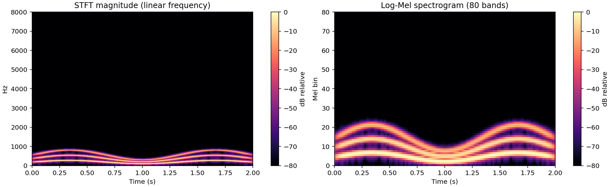

# 第05课｜Vocoder 与 HiFi-GAN：从频谱回到可播放的波形

> **本课目标**：亲耳比较完整 STFT、只保留幅度和 Mel 后的恢复；理解 Generator、MPD/MSD 与 Codec Decoder 的关系。

## 一眼看懂数据流

```text
TTS 声学模型 → Mel `[B,80,T]` → 神经 Vocoder（多级上采样）→ PCM `[B,1,N]`
```

## 1. 为什么有 Mel 还不能直接播放

PCM 是直接可播放的振幅序列；复数 STFT 保存幅度与相位，满足条件时经 iSTFT 能基本恢复波形；幅度谱丢失相位；Mel 进一步把频率分量聚合。由 Mel 不能唯一确定原始 PCM。

把正弦波统一平移180°，其单独播放的音高与稳态响度基本不变；但两条同频同幅正弦叠加时，相差180°的成分可能完全抵消。复杂声音的**相对相位与瞬态**会影响听感。因此 Vocoder 需要合成时间结构合理的波形，而不只是回填随机相位。

## 2. 传统算法与神经模型对比

- iSTFT：已知复数谱，可逆变换。
- Griffin–Lim：只知道幅度，反复估计一个与谱大体一致的相位；无需深度学习。
- Mel + Griffin–Lim：需要先近似恢复线性频率幅度谱，再估计相位，误差更大。
- HiFi-GAN：用真实 PCM/Mel 配对训练 Generator，输出波形；判别器只在训练时参加，用于鼓励真实感。

## 3. HiFi-GAN 核心结构

输入 `[B,80,T]`，Conv1D 形成高通道隐藏特征；ConvTranspose1D 按 `×8、×8、×2、×2` 等配置逐级恢复时间分辨率；MRF 多感受野残差网络强化不同时间尺度的声学结构；最终一通道 PCM。

训练时多周期判别器 MPD 更关注周期结构，多尺度判别器 MSD 观察不同时间分辨率；与频谱重建和特征匹配损失共同训练。**推理时不要运行判别器。**

## 4. 与 Neural Codec Decoder 的区别

Vocoder 的输入通常是 Mel 或声学特征；离散 Codec Decoder 的输入通常来自码本查表恢复的 Latent。两者都能使用卷积上采样网络，区别主要在输入表示、训练目标和系统分工。CosyVoice2 典型走 `Flow → Mel → HiFT`，Qwen3-TTS-12Hz 典型走 `多码本 Token → Codec Decoder`。

## 5. 实验解释

`lesson5_vocoder_lab.py` 用传统算法对同一音频做四条路线，不是预训练 HiFi-GAN；`tiny_vocoder_architecture.py` 只展示未训练网络的形状与反向传播，**生成的随机波形没有语音意义**。

录音的 Mel 参数必须匹配所用 Vocoder 的训练配置（采样率、FFT、hop、fmin/fmax、mel 定义及归一化）。不能随意拿 Whisper 的 Log-Mel 交给别的 Vocoder。

## 动手运行

从**仓库根目录**执行：

```bash
python lessons/05-vocoder-hifigan/code/lesson5_vocoder_lab.py --input lessons/05-vocoder-hifigan/code/demo_synthetic.wav --output-dir outputs/lesson05 --iterations 16
```

```bash
python lessons/05-vocoder-hifigan/code/tiny_vocoder_architecture.py
```

> 如本课含可下载权重的官方示例，先阅读 `../../docs/installation.md`，该步骤不计入无需网络的 CPU 实验。

## 实验图示（合成或教学数据）



## 课程附带素材 / 预期结果

- `outputs/lesson05/01_original.wav` 等四条重建对照
- `outputs/lesson05/stft_vs_logmel.png`
- `outputs/lesson05/waveforms_comparison.png`

## 验收题

- [ ] 能说明 Mel 丢失哪些信息
- [ ] 能解释为什么绝对相位与相对相位不同
- [ ] 看懂 `[B,80,100] → [B,1,25600]` 的上采样
- [ ] 区分 Generator 与判别器

## 论文与官方项目

- https://github.com/jik876/hifi-gan
- https://arxiv.org/abs/2010.05646

**延伸问答**：参见 [问答索引](../../docs/qa/README.md)；实验性质说明见 [证据与限制](../../docs/evidence-and-limitations.md)。
