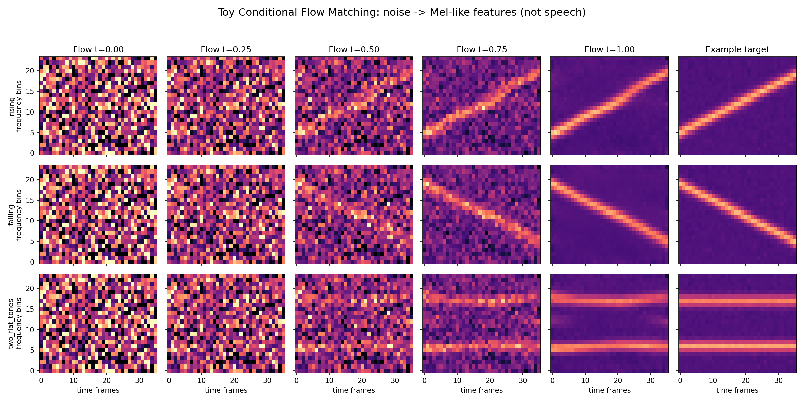

# 第06课｜CosyVoice 与 Flow Matching：从语义语音 Token 生成连续 Mel

> **本课目标**：理解语音 Token、条件速度场与 Vocoder 分工；亲手训练一个从噪声出发生成不同频谱纹理的小型 Flow 模型。

## 一眼看懂数据流

```text
文字 → Text/Speech LLM → 语音 Token → 条件 Flow Matching → Mel → HiFT Vocoder → PCM
```

## 1. 为什么有 Speech Token，还需要 Flow

CosyVoice2 的 LLM 主要决定语言内容的离散语音结构；而完整声学波形包含音色、谐波、韵律和动态细节。其 Flow 网络接受语音 Token、说话人条件、当前状态与生成进度，并构造连续 Mel，最终交由 HiFT 变成 PCM。这是系统架构选择，并不是所有 TTS 必须包含 Flow。

## 2. Flow 训练时真正的标签

真实 Mel 是 `x1`，随机高斯噪声 `x0`，训练时随机选择 `[0,1]` 中的 `t`：

```python
x_t = (1-t)*x0 + t*x1
velocity_target = x1 - x0
velocity_pred = flow_model(x_t, t, condition)
loss = ((velocity_pred - velocity_target)**2).mean()
```

这里线性插值路径只是易于理解的例子；CosyVoice 的实际实现还有特定调度、掩码、CFG 和条件网络。**训练时知道 x1，推理时不知道。**

推理以随机噪声为起点，反复调用速度网络，通过数值积分（如 Euler）逐步推进到接近真实条件数据分布的样本。

## 3. 两种时间不能混

音频时间是 Mel 的横轴，例如50Hz表示每秒50帧。Flow 时间 `t` 是生成算法从噪声到成品的进度。例如对一个 `[80,50]` Mel 块做10次 Flow 迭代，是**10次修改整张声学特征块**，而不是只产生10个真实音频帧。

## 4. Flow、Diffusion、GAN 的关系

Flow 学速度场；Diffusion 常学去噪或得分相关目标；GAN 让 Generator 与判别器对抗。它们都属于生成建模路线，但损失、采样方法、计算路径不同。增大 Flow 数值积分步数并不总是线性提升听感，步数增加会增加计算成本。

## 5. 配套实验

`toy_flow_matching.py` 是**条件生成二维合成频谱纹理**的小型 CNN 速度场，条件分别是频率上升、下降与双频率。它不生成真实中文语音。

`cosyvoice2_inference_example.py` 调用**官方预训练 CosyVoice2**，需要在上游仓库安装模型、给出参考语音与相应文字，不能当作离线 toy 脚本的一部分。

## 动手运行

从**仓库根目录**执行：

```bash
python lessons/06-cosyvoice-flow/code/toy_flow_matching.py --steps 500
```

```bash
python lessons/06-cosyvoice-flow/code/cosyvoice2_inference_example.py --help
```

> 如本课含可下载权重的官方示例，先阅读 `../../docs/installation.md`，该步骤不计入无需网络的 CPU 实验。

## 实验图示（合成或教学数据）



## 课程附带素材 / 预期结果

- `figures/flow_steps.png`：从噪声到合成频谱
- `figures/loss.png`：实际教学训练过程
- 训练生成的模型权重（默认不纳入版本控制）

## 验收题

- [ ] 能解释 Flow 的 x0、x1、xt、t 和速度
- [ ] 区分训练与推理的目标信息
- [ ] 区分 Flow 进度与声音真实时间
- [ ] 明确 Flow 不能直接替代 Vocoder

## 论文与官方项目

- https://github.com/FunAudioLLM/CosyVoice
- https://arxiv.org/abs/2412.10117

**延伸问答**：参见 [问答索引](../../docs/qa/README.md)；实验性质说明见 [证据与限制](../../docs/evidence-and-limitations.md)。
