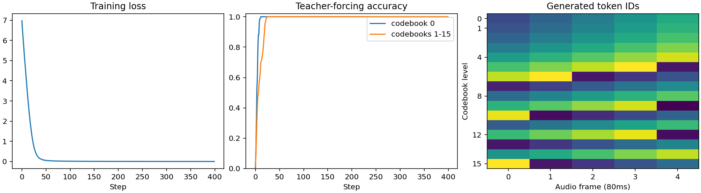

# 第07课｜Qwen3-TTS：语义码本、MTP 与 Codec 流式解码

> **本课目标**：能画出时间维 T 与码本维 K 的二维结构，理解一个大主干和小预测器如何分工，运行 toy 多码本生成。

## 一眼看懂数据流

```text
文本 Token / 音色条件 → Talker Transformer → C0 → MTP Code Predictor → C1…C15 → 12.5Hz Codec Decoder → PCM
```

## 1. 第七课为什么不再讲 Flow

**Qwen3-TTS 是模型家族**，这里重点是12.5Hz 多码本路线：它使用语义与声学码本，后接因果神经 Codec Decoder。并不意味着 Qwen3-TTS 所有版本都没有 Flow；25Hz 路线有不同的声学生成架构。

## 2. 一个80ms时间帧有多少 ID

24kHz 的80ms有1920个 PCM 采样点；12.5Hz表示每秒约12.5个音频时间帧。在12Hz路线中，一个时间位置有16个码本 ID。典型配置每组码本为2048个候选向量。2秒大约25帧，即约400个码本 ID。**不意味着大模型进行400次完整前向**。

`codes.shape ≈ [B,T,16]` 是二维时间×码本深度上的结构。在推理中，大型 Talker Backbone 主要预测语义码本 C0，再通过较小的多 Token 预测模块 MTP 预测其余码本；Codec Decoder 查表并逐步恢复 PCM。前者沿时间推进，后者沿同一时间帧的码本层级推进。

## 3. 与 CosyVoice 的系统差异

- CosyVoice2：`Speech Token → Flow Matching → Mel → HiFT Vocoder`。
- Qwen3-TTS-12Hz：`多码本 Speech Token → 训练好的神经 Codec Decoder → PCM`。

共同点是大模型不直接逐采样点生成 PCM。两条路线的首包与 RTF 优势依赖实际硬件与实现；**不能仅凭省掉 Flow 就断言整体吞吐更高**。

## 4. 如何训练

阶段一训练 Codec（录音→编码→重建录音），码本与 Encoder、Decoder 学会保留高质量声学信息。阶段二用文字/配对录音训练 Talker；对真实录音运行已训练 Codec Encoder，生成 `[T,16]` 的目标码本矩阵，再逐层用 Cross Entropy 学习对应 ID。

## 5. 实验的真实边界

`toy_multicodebook.py` 使用一个小 GRU 和 MTP 学人为定义的 ID 关系，输出合成音调；该 toy 100% 的准确率不是 Qwen3-TTS 真正的语言语音指标。`official_qwen3_tts_inference.py` 和 `official_tokenizer_encode_decode.py` 是官方模型的调用入口，需要独立安装及下载权重。

## 动手运行

从**仓库根目录**执行：

```bash
python lessons/07-qwen3-tts/code/toy_multicodebook.py --steps 400
```

```bash
python lessons/07-qwen3-tts/code/official_tokenizer_encode_decode.py --audio YOUR_AUDIO.wav --device cuda:0
```

> 如本课含可下载权重的官方示例，先阅读 `../../docs/installation.md`，该步骤不计入无需网络的 CPU 实验。

## 实验图示（合成或教学数据）



## 课程附带素材 / 预期结果

- `figures/training_and_codes.png`：码本训练曲线
- `samples/synthetic_*_codebooks.wav`：数学合成音调
- 真实 Codec 解码得到的 WAV（需自行运行）

## 验收题

- [ ] 能解释 `[B,T,16]`
- [ ] 能说明 C0 与 C1～C15 的区别
- [ ] 能区分 MTP 和 Transformer 主干的计算责任
- [ ] 不把模拟声和真实 TTS 音质混为一谈

## 论文与官方项目

- https://github.com/QwenLM/Qwen3-TTS
- https://huggingface.co/Qwen/Qwen3-TTS-Tokenizer-12Hz

**延伸问答**：参见 [问答索引](../../docs/qa/README.md)；实验性质说明见 [证据与限制](../../docs/evidence-and-limitations.md)。
