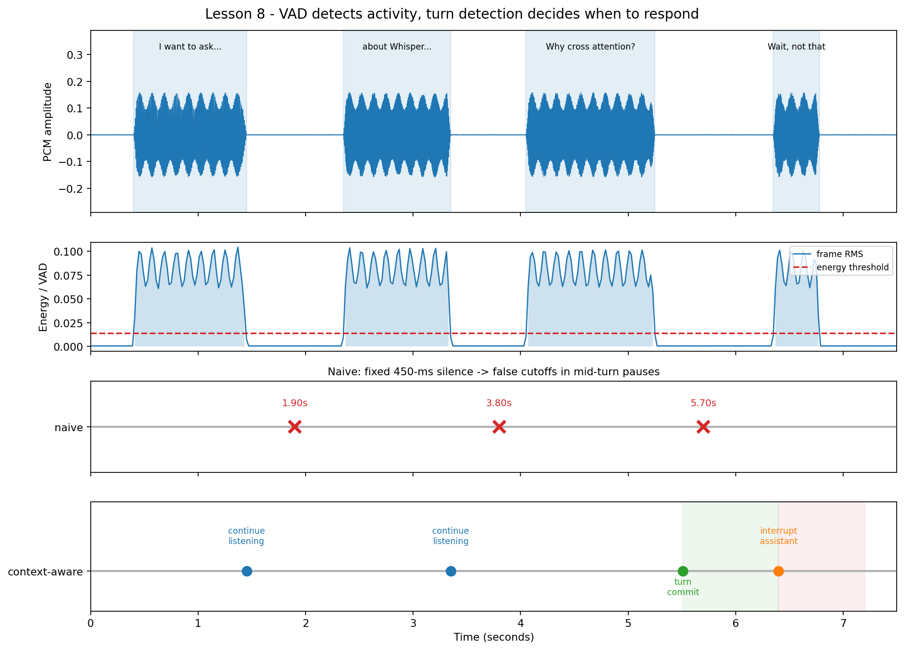

# 第08课｜VAD、End-of-Turn 与打断检测

> **本课目标**：区分“停止说话”和“轮到 AI 说”，分析固定静音阈值的抢话问题，理解双工系统的 AEC/缓冲与打断控制。

## 一眼看懂数据流

```text
麦克风 PCM → VAD / 语义与声学 Turn Detector → CONTINUE / END → AI 回复；说话期间继续监听 → 打断 / 附和 / 噪声区分
```

## 1. VAD 不等于话轮结束

VAD 判断当前是否属于语音活动，能量阈值 RMS 是最基础示例；学习式 VAD 能更好地区分语音与音乐/噪声，但通常不能仅依 VAD 判断意图是否完成。

用户说“我想问一下……”，中间静音600ms，VAD 可能输出非语音，但 **Turn Detector** 可能根据语义、语调和说话节奏判定 Continue。若用户说“Whisper 为什么用 Cross Attention？”再停顿，则更倾向 End。

## 2. 固定静音阈值的代价

等450ms可能在长停顿时抢话；等1000ms减少误判，却增加用户完整说完后的响应时间。一个有效话轮检测器需要同时优化 False Cutoff Rate 与 End-of-Turn Latency。

## 3. 打断与回声消除

AI 播放时麦克风仍然接收输入：用户可能说“等一下”，也可能只是“嗯嗯”附和，或扬声器声音漏入麦克风。因此需结合 AEC 回声消除、VAD、语义、播放器控制与取消策略。

要取消的不只是 GPU 中尚在生成的音频，还包括服务器发送队列与浏览器未播放缓存。工程上可给每次回答加 `generation_id`，丢弃过期代次的音频。

## 4. 如何训练

训练标签不是整段声音类别，而是**对话中的截止位置**：同一段长录音截在尚未完成处标 Continue，截在真实终止位置标 End。随机裁短片段再继承最终 End 标签，会引入错误监督。

## 5. 本课两条代码路径

`lesson8_turn_lab.py` 使用可听的合成信号 + 人工语义标签，能重现固定超时与上下文决策的差异；它不是训练好的神经 Turn Detector。`silero_real_vad.py` 调用预训练 Silero 对你自己有权使用的语音求时间戳，但这仍然**不是**话轮语义判断。

## 动手运行

从**仓库根目录**执行：

```bash
python lessons/08-vad-turn-taking/code/lesson8_turn_lab.py
```

```bash
python lessons/08-vad-turn-taking/code/silero_real_vad.py YOUR_SPEECH.wav
```

> 如本课含可下载权重的官方示例，先阅读 `../../docs/installation.md`，该步骤不计入无需网络的 CPU 实验。

## 实验图示（合成或教学数据）



## 课程附带素材 / 预期结果

- `figures/turn_timeline.png`：语音活动和话轮策略
- `samples/synthetic_turns.wav`：人工合成声学片段
- 运行后 `results/events.csv`：事件日志

## 验收题

- [ ] 能解释为什么 VAD 不能替代 Turn Detector
- [ ] 理解静音等待阈值与抢话/延迟的权衡
- [ ] 解释打断为何要清理播放缓冲
- [ ] 能设计端点监督数据

## 论文与官方项目

- https://github.com/snakers4/silero-vad
- https://github.com/pipecat-ai/smart-turn
- https://docs.livekit.io/agents/

**延伸问答**：参见 [问答索引](../../docs/qa/README.md)；实验性质说明见 [证据与限制](../../docs/evidence-and-limitations.md)。
