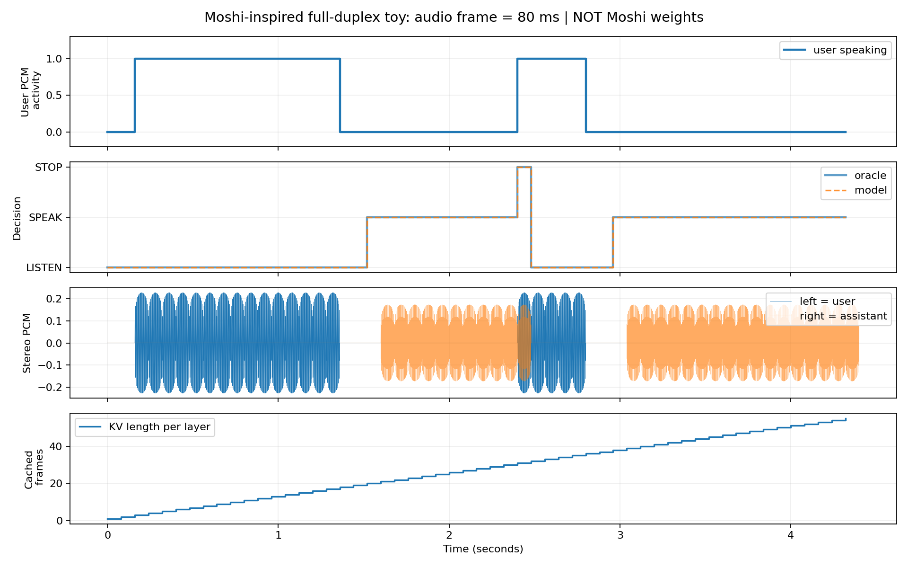

# 第09课｜Moshi 与 Mimi：Temporal / Depth Transformer 全双工建模

> **本课目标**：解释双音频流与可选文字流、连续因果推理、时间与码本两个自回归维度，运行逐帧 KV Cache 演示。

## 一眼看懂数据流

```text
24kHz 用户 PCM → Mimi Encoder(12.5Hz) → Temporal Transformer(KV Cache) → Depth Transformer(码本) → Mimi Decoder → AI PCM（同时继续接收用户音频）
```

## 1. Moshi 为什么和串行 ASR→LLM→TTS 不同

串行系统通常在输入分段后进行识别、文本推理与 TTS；Moshi 把用户音频、AI 自己的音频和用于指导自己输出的文字对齐到统一的时间结构中，允许持续听并按需发声。**Moshi 的 Inner Monologue 是其输出端的文字表示，不意味着必须先把用户的整句音频识别为文字。**

## 2. Mimi 压缩与两个轴

Mimi 使用24kHz音频、12.5Hz低帧率，一帧约80ms。音频编码为多组码本：语义 VQ 与声学 RVQ 组合，不能粗略地说所有层都只修正同一个语义残差。

- **Temporal Transformer**：沿音频时间位置自回归，在收到新的压缩输入时追加每层 KV，建模长期上下文。
- **Depth Transformer**：在当前生成位置的码本深度方向按依赖关系生成多码本音频表示。大型时间主干不需要对每个码本位置反复运行全套大网络。
- **Mimi Decoder**：把新输出的音频编码变回可连续播放的 PCM。

实际 Moshi 还有语义与声学编码之间的延迟对齐，不能机械认为同一80ms的8个 ID 都同时生成。

## 3. 用户持续讲话会发生什么

“因果注意力”只是规定过去位置不能看到未来位置，**不规定接口要不要等待整句话**。流式模型逐帧追加可用的输入，历史 K/V 对给定因果位置保持稳定。没有说话时，持续接收音频并不必然要求大型模型一直以完全相同的频率推理；这由部署系统是否允许休眠与恢复来决定。

## 4. 上下文与静音问题

音频静音本身有时间与节奏意义，若静音位置也送入 Temporal Transformer 就会占用上下文。可通过有限窗口/Ring KV Cache、会话休眠、摘要等处理。**有限 KV 窗口不等于拥有长期记忆**；长会话若想记得数十分钟前的内容还需外部状态或摘要。

## 5. 实验的边界

`lesson9_moshi_toy.py` 训练的是使用合成的 Listen/Speak/Stop 标签的小型因果 Temporal 和码本 Depth 模型，并输出左/右声道的数学音调；**它不是公开 Moshi 的人声质量或实际毫秒级延迟复现**。

## 动手运行

从**仓库根目录**执行：

```bash
python lessons/09-moshi-full-duplex/code/lesson9_moshi_toy.py --steps 350 --output outputs/lesson09
```

> 如本课含可下载权重的官方示例，先阅读 `../../docs/installation.md`，该步骤不计入无需网络的 CPU 实验。

## 实验图示（合成或教学数据）



## 课程附带素材 / 预期结果

- `figures/full_duplex_timeline.png`：逐帧状态与 KV
- `samples/full_duplex_stereo.wav`：两路合成音调
- `outputs/lesson09/per_frame_log.csv`：逐帧输出

## 验收题

- [ ] 解释 Temporal 与 Depth 两个维度
- [ ] 解释历史 K/V 为什么可以缓存
- [ ] 能听出双方同时发声与打断的时间重叠
- [ ] 明确合成策略与真实全双工能力的区别

## 论文与官方项目

- https://github.com/kyutai-labs/moshi
- https://arxiv.org/abs/2410.00037

**延伸问答**：参见 [问答索引](../../docs/qa/README.md)；实验性质说明见 [证据与限制](../../docs/evidence-and-limitations.md)。
