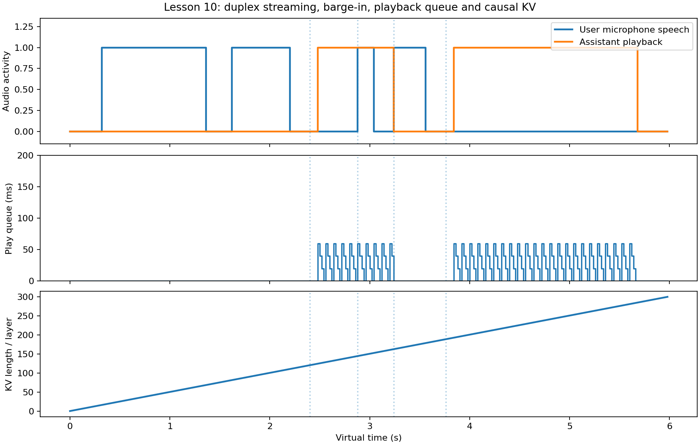

# 第10课｜架构收官：WebRTC、模型 Worker、Session、KV、打断与长会话

> **本课目标**：设计完整 S2S 低延迟服务，运行控制面模拟器，区分 GPU 计算、网络、音频播放与上下文管理。

## 一眼看懂数据流

```text
浏览器麦克风(WebRTC/AEC) ↔ Realtime Media Gateway ↔ Session Orchestrator ↔ Streaming Model Worker(Encoder/LLM/Decoder) ↔ PCM 播放
```

## 1. 模型架构与系统架构不是一回事

一个训练好的端到端 S2S 模型不等于可提供长期服务的产品。需要媒体网关（网络传输、抖动缓冲、重采样、AEC）、会话路由、GPU 模型 Worker、打断与播放控制、指标与异常恢复。原生模型可将感知、话轮与声音生成整合在一个主干，不意味着所有子功能都必须拆成独立服务。

## 2. 一次用户对话的时间关系

持续接收20ms PCM帧；模型可能每80ms形成一段 Codec 时间位置；若用户尚未说完，继续监听但不必一定提交回答；确认说完后，模型生成第一块音频就立即送往播放队列；用户打断时取消正在生成、排队和浏览器待播放的旧音频。

`generation_id` 是一种推荐的幂等和防旧帧机制；它不是特定官方协议强制要求的字段。

## 3. KV Cache 管理

每个活跃会话保存不同的每层 KV；模型权重通常可以跨会话共享。Prefix Cache 复用相同前缀，而 Session KV 保持连续时间上下文，两者机制不同。音频场景的历史长度可能很快增长：12.5Hz 一小时就是45,000个模型时间位置（不代表模型可支持这么长的有效上下文）。

Ring KV 固定单会话的注意力窗口和显存上限；更长时间重要信息则需要摘要、外部记忆、替换实例或重新 Prefill。静音不是免费的历史：如果仍输入主 Transformer，它可能持续消耗上下文位置。

## 4. 实时性能指标

- 用户表达完成到第一段**实际播放**声音的延迟，而不只是网络收到第一 Token。
- 有效打断到旧音频停止播放的延迟。
- Frame processing deadline、输出缓冲欠载、输入抖动、GPU 调度尾延迟、KV 占用及多会话负载。

例如模型时间帧为80ms，若长期串行处理一帧超过80ms，队列会积压。但平均低于80ms也不保证 P95/P99 不会破坏播放节奏。

## 5. 外部项目的参考路线

- Moshi：原生多流语音建模，适合研究模型内部逐帧推理。
- Sophon-Realtime：模型家族及话轮/打断控制，适合集成研究。
- LiveKit：WebRTC 和语音 Agent 编排，适合搭产品。
- OpenAI GPT-Live：公开了媒体前端、有状态连续推理、异步任务、上下文压缩等工程思想；**内部模型参数和精确实现并未全部公开**。

## 6. 本课实验是调度模拟，不是性能压测

`lesson10_simulator.py` 用合成音调和虚拟时间验证持续监听、输出重叠、增量 KV 等效和旧代次取消。280ms等数字来自**人为设定的模拟时钟**，不得在 README 宣称为实测 OpenAI/Moshi/Sophon 低延迟。

## 动手运行

从**仓库根目录**执行：

```bash
python lessons/10-realtime-system/code/lesson10_simulator.py --out outputs/lesson10
```

> 如本课含可下载权重的官方示例，先阅读 `../../docs/installation.md`，该步骤不计入无需网络的 CPU 实验。

## 实验图示（合成或教学数据）



## 课程附带素材 / 预期结果

- `figures/timeline.png`：输入/播放/KV 时间线
- `samples/simulated_duplex_stereo.wav`：双路模拟声音
- `outputs/lesson10/{frames.csv,events.json,metrics.json}`：运行日志

## 验收题

- [ ] 能画出完整 S2S 服务拓扑
- [ ] 能说明停止 GPU 不等于浏览器立即停止旧音频
- [ ] 能解释 Session KV 与 Prefix Cache
- [ ] 能区分模拟 RTT 与真实端到端测量

## 论文与官方项目

- https://github.com/kyutai-labs/moshi
- https://github.com/adventists-ai/sophon-realtime
- https://openai.com/index/continuous-voice-interaction-with-gpt-live/
- https://docs.livekit.io/agents/

**延伸问答**：参见 [问答索引](../../docs/qa/README.md)；实验性质说明见 [证据与限制](../../docs/evidence-and-limitations.md)。
